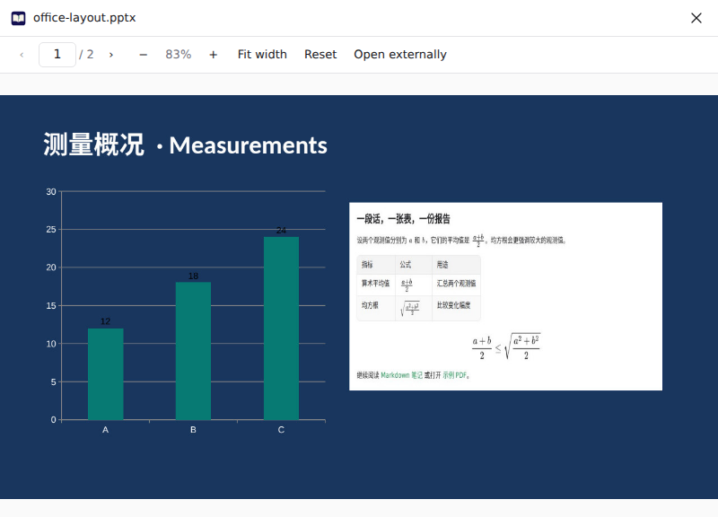

# Paseo Omni Reader

[简体中文](README.zh-CN.md)

Omni Reader adds LaTeX to streaming assistant replies and read-only previews for Markdown, PDF, Word, Excel and PowerPoint.


## What you can read

- **Assistant replies.** Complete formulas render during streaming. Inline fractions have room to show their numerator and denominator, and standalone equations are centered. Tables size their columns to their content and center when they fit. Wide tables and long code scroll horizontally. Hover to see LaTeX or click to copy in a browser. Touch and hold any formula in the native app to see or copy its source. Use **Restore original reply** below an enhanced reply to return to Paseo’s Markdown. **Resume rendering** appears in the same spot. Paseo provides the turn footer in both views. Inline and display formulas follow Paseo’s content font size. Choose a separate size preset from 50% to 200% for each in the plugin settings.
- **Workspace files.** Open Markdown, `.pdf`, `.docx`, `.xlsx`, and `.pptx` from chat links or the file tree. Paseo’s **Open location** settings let you choose the main panel or side pane separately for chat links and file tree selections. Phones use Paseo’s file preview sheet. Markdown uses the same formula settings as chat, supports preview/source switching, and loads large documents as you read.
- **Continuous pages.** PDF and formatted Office pages stack vertically. At 100%, each entire page fits the preview with either its width or height filling the available space. Drag the zoom slider or enter a percentage from 25% to 400%. Hover over toolbar icons for labels. Scroll with the mouse wheel and drag to pan. Click the preview and press `+`, `-`, or `0` to zoom in, zoom out, or fit the page. On native clients, pinch to zoom and pan with one finger.
- **Excel worksheets.** Read sheets in a scrollable grid with row and column headings, workbook tabs, and the file’s column widths, merged cells, and basic cell styling. Use **Print layout** to view the formatted print output and charts when LibreOffice is available on the Paseo host.
- **External editing.** In Paseo Desktop, **Open externally** opens the original file in the system’s default app when the workspace is on the local daemon. Browsers and remote desktop workspaces download a copy. On iOS and Android, the action hands a copy to the system share sheet. On Android builds where sharing is unavailable, use **Download** from Paseo’s file menu.

| PDF reader | Office preview |
| --- | --- |
|  |  |

## Install from GitHub

Use Paseo 0.17.5 or newer on the client and daemon. The daemon host needs Node.js 22 or newer and npm for Git installation.

```sh
paseo plugin install github:Fu021/paseo-omni-reader
```

Paseo opens the preview directly when Omni Reader is the only available viewer. If Paseo asks about Markdown, choose Omni Reader and remember the choice. On mobile, the file preview uses Paseo’s close button. Plugin controls are in Simplified Chinese when Paseo uses Simplified Chinese, and in English for other locales.

## Data and limits

The Paseo daemon reads files inside the active workspace and sends rendered content to the connected client. Install LibreOffice Writer, Calc, and Impress on that host to see formatting, images, charts, and pagination in Office print previews. The browser and native apps display the same read-only previews. The Excel worksheet grid works without LibreOffice. Without LibreOffice, Word and PowerPoint offer basic text previews. PDF previews accept files up to 128 MiB and Office previews accept files up to 24 MiB. Failed formulas keep their source and offer a retry.

For development, run `npm ci --include=dev --ignore-scripts`, `npm run typecheck`, `npm test`, and `npm run check:package`. With LibreOffice Writer, Calc and Impress installed, run `npm run test:office` to test formatted Office previews. GitHub Actions runs these checks on Linux with Node.js 22 and 24, with LibreOffice on Node.js 24. See the marketplace overviews in [English](OVERVIEW.md) and [简体中文](OVERVIEW.zh-CN.md).
