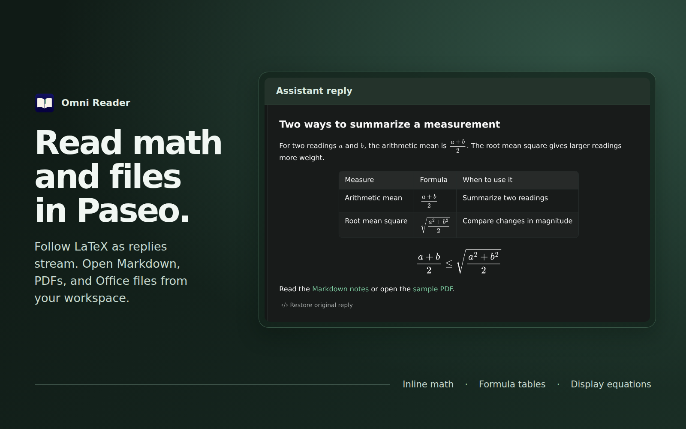

# Omni Reader

[简体中文](README.zh-CN.md)

Omni Reader adds LaTeX to streaming assistant replies and read-only previews for Markdown, PDF, Word, Excel and PowerPoint.



## What you can read

- **Assistant replies.** Complete formulas render during streaming. Inline fractions have room to show their numerator and denominator, and standalone equations are centered. Tables size their columns to their content and center when they fit. Wide tables and long code scroll horizontally. Hover to see LaTeX or click to copy in a browser. On mobile, tap a formula to preview it and copy its LaTeX. Use **Copy LaTeX source** in the preview to copy it again. Use **Restore original reply** below an enhanced reply to return to Paseo’s Markdown. **Resume rendering** appears in the same spot. Paseo provides the turn footer in both views. Inline and display formulas follow Paseo’s content font size. Choose a separate size preset from 50% to 200% for each in the plugin settings.
- **Workspace files.** Open Markdown (`.md`, `.markdown`, `.mdown`, `.mkd`, `.mkdn`, `.mdwn`), `.pdf`, `.docx`, `.xlsx`, and `.pptx` from chat links or the file tree. Paseo’s **Open location** settings let you choose the main panel or side pane separately for chat links and file tree selections. Each viewer shows **Omni Reader** and the file size above the controls. Markdown also shows the line count, uses the same formula settings as chat, and loads large documents as you read. On desktop, rendered Markdown follows Paseo’s **Appearance → Content width** setting.
- **Continuous pages.** PDF and formatted Office pages stack vertically. At 100%, each entire page fits the preview with either its width or height filling the available space. Drag the zoom slider or enter a percentage from 25% to 400%. Hover over toolbar icons for labels. Scroll with the mouse wheel and drag to pan. Click the preview and press `+`, `-`, or `0` to zoom in, zoom out, or fit the page. On native clients, pinch to zoom and pan with one finger.
- **Excel worksheets.** Read sheets in a scrollable grid with row and column headings, workbook tabs, merged cells, and basic cell styling. Columns expand to fit their contents and long text wraps onto taller rows. Pinch to zoom and drag with one finger on a phone. Use **Print layout** to view the formatted print output and charts when LibreOffice is available on the Paseo host.
- **External editing.** In Paseo Desktop, **Open externally** opens the original file in the system’s default app when the workspace is on the local daemon. Browsers and remote desktop workspaces download a copy. On iOS and Android, the action hands a copy to the system share sheet. On Android builds where sharing is unavailable, use **Download** from Paseo’s file menu.

Markdown supports in-document links and a numbered, read-only source view. Wide desktop and tablet panels open with the preview on the left and the source on the right. On phones and in narrow panels, select **Split preview and source** to show the preview above the source. An open split adapts as the panel resizes. Scroll either pane to move the other with it. A block’s source button briefly highlights its original lines and scrolls to them when they are outside the view. Select source text directly to copy it. The preview also shows YAML front matter and respects the author’s table alignment.

Use **Find** or press `Ctrl+F` or `Cmd+F` while working in the Markdown panel. Find stays in the current view, marks the matching block in the preview and highlights the exact text in source. Search shows the current match and total, with options for case, whole words, and regular expressions. Press `Enter` or `Shift+Enter` to navigate and `Escape` to close. Search includes portions of the file you have yet to load.

PDF and formatted Office previews share the Markdown find controls and highlight matches on the page or slide as you type. Find floats over the content and preserves the current page fit. Drag across text on desktop or touch and hold on a phone, then copy the selection. PDF selection and search require a text layer. PowerPoint opens with slide thumbnails on the left. Use the toolbar to hide them and give the slide more space. In Excel, entering `X604` in Find includes that address and any matching cell text in the active sheet. Enable **Cell address only** to jump directly. Select cell text directly or tap a cell on a phone to copy its full value. Right-click a cell or touch and hold to independently freeze or unfreeze its row and column.

| Markdown and formula settings | PDF and Office previews |
| --- | --- |
|  |  |

## Install

Use Paseo 0.17.5 or newer on the client and daemon. Paseo 0.17.5 is the first release that preserves native reply actions, including branching and turn statistics, alongside enhanced replies. Install **Omni Reader** from the Paseo marketplace or run:

```sh
paseo plugin add fu021/omni-reader
```

To install from GitHub, the daemon host needs Node.js 22 or newer and npm:

```sh
paseo plugin install github:Fu021/paseo-omni-reader
```

Paseo uses your saved file associations for chat links and the file tree. When Paseo asks which viewer to use, choose Omni Reader and remember the choice. Plugin controls are in Simplified Chinese when Paseo uses Simplified Chinese, and in English for other locales.

On a phone, previews open in Paseo’s file panel. Use Paseo’s × to close the preview.

## Data and limits

The Paseo daemon reads files inside the active workspace and sends rendered content to the connected client. Install LibreOffice Writer, Calc, and Impress on that host to see formatting, images, charts, and pagination in Office print previews. The browser and native apps display the same read-only previews. The Excel worksheet grid works without LibreOffice. Without LibreOffice, Word and PowerPoint offer basic text previews. PDF previews accept files up to 128 MiB and Office previews accept files up to 24 MiB. Failed formulas keep their source and offer a retry.

The file size and line count follow Paseo’s interface font size. In the browser and desktop client, Markdown source follows Paseo’s code font, code size, and syntax colors. The native source view uses the platform monospace font and follows system text scaling.

For development, run `npm ci --include=dev --ignore-scripts`, `npm run typecheck`, `npm test`, and `npm run check:package`. With LibreOffice Writer, Calc and Impress installed, run `npm run test:office` to test formatted Office previews. GitHub Actions runs these checks on Linux with Node.js 22 and 24, with LibreOffice on Node.js 24. See the marketplace overviews in [English](OVERVIEW.md) and [简体中文](OVERVIEW.zh-CN.md).

`npm run pack:release` builds the npm archive with the rendering workers and locked dependencies. `npm run check:package` also installs the archive locally in a temporary directory to check that it works with lifecycle scripts disabled.
