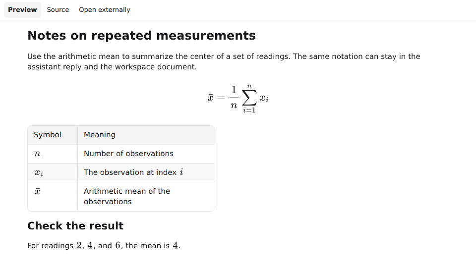
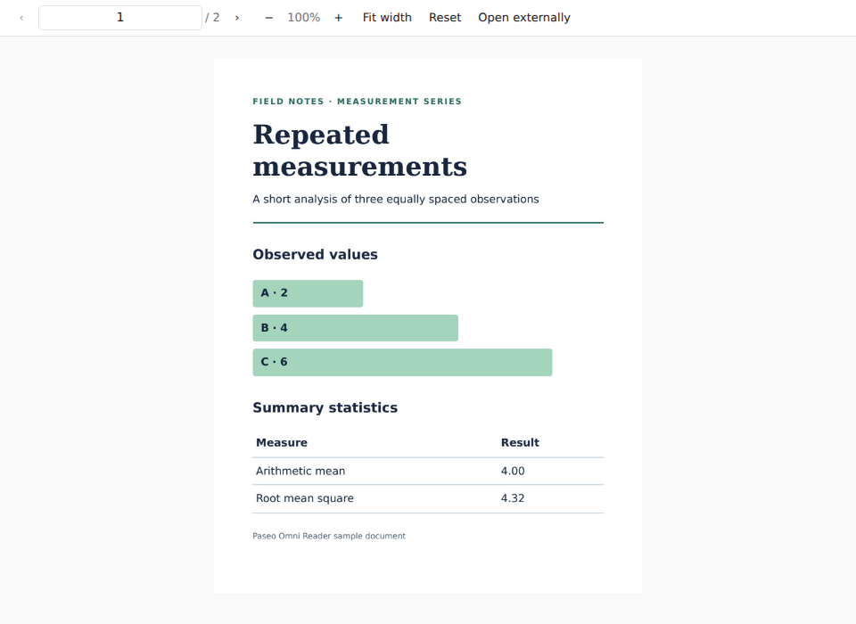

# Paseo Omni Reader

[简体中文](README.zh-CN.md)

Omni Reader adds LaTeX to streaming assistant replies and read-only previews for workspace files, from Markdown notes and spreadsheets to PDFs.


## What you can read

- **Assistant replies.** Complete formulas render during streaming. Inline fractions have room to show their numerator and denominator, standalone equations are centered, and wide tables and long code scroll horizontally. Hover to see LaTeX or click to copy in a browser. Touch and hold any formula in the native app to see or copy its source.
- **Workspace documents.** Switch Markdown between preview and source, or keep reading large UTF-8 files as sections load. Preview Word paragraphs and tables, Excel worksheets, PowerPoint slide text, CSV and TSV tables, HTML, SVG, and common images. Links with a source line, such as `example.ts#L31`, use Paseo’s line navigation.
- **PDFs.** Drag a page with a mouse or pinch and pan in the native full-screen reader. Jump to a page, fit the page width or restore 100% zoom.
- **External editing.** **Open externally** downloads a copy in a browser or shares a copy with another app on iOS and Android. On Android builds where the share sheet is unavailable, use **Download** from Paseo’s file menu. Preview panels are read-only.

| Markdown preview | PDF reader |
| --- | --- |
|  |  |

## Install from GitHub

Use Paseo 0.17.4 or newer on the client and daemon. The daemon host needs Node.js 22 or newer and npm for Git installation.

```sh
paseo plugin install github:Fu021/paseo-omni-reader
```

In Paseo, select the Omni Reader panel in **Open with** and remember the choice on each client. Plugin controls are in Simplified Chinese when Paseo uses Simplified Chinese, and in English for other locales.

## Data and limits

The Paseo daemon reads files inside the active workspace and sends rendered content to the connected client. The plugin uses no external rendering service. PDF previews support files up to 128 MiB. Structured Office and CSV previews accept files up to 24 MiB and show a limited number of pages, rows and cells. Failed formulas keep their source and offer a retry.

For development, run `npm ci --ignore-scripts`, `npm run typecheck`, and `npm test`. See the marketplace overviews in [English](OVERVIEW.md) and [简体中文](OVERVIEW.zh-CN.md).
