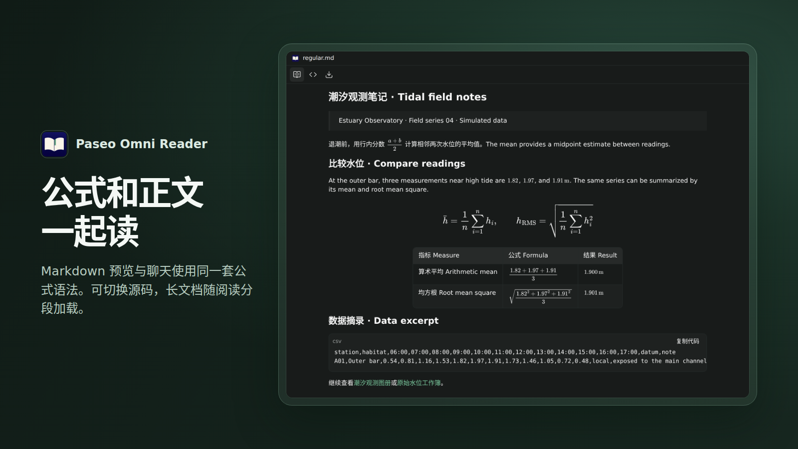
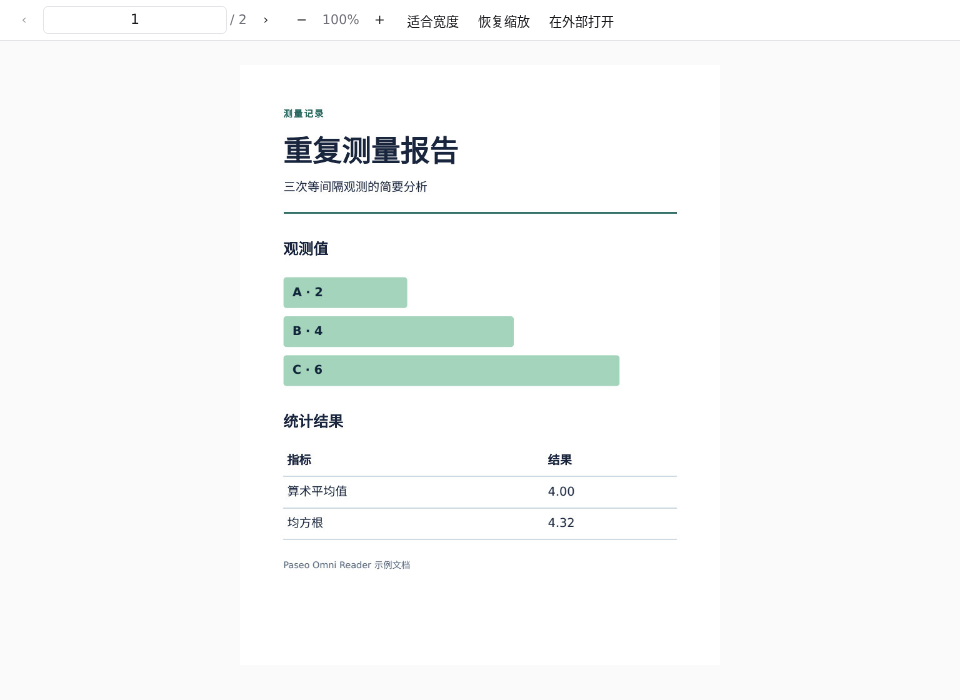

# Paseo Omni Reader

[English](README.md)

Omni Reader 是 Paseo 阅览增强插件。它为流式聊天加入 LaTeX 排版，也为工作区里的笔记、表格、PDF 和其他常见文件提供只读预览。


## 阅览体验

- **聊天公式。** 公式闭合后开始渲染。行内分数按分子和分母所需的高度排版，独立公式居中，宽表格和长代码各自横向滚动。浏览器悬停看 LaTeX 原文，点击复制。原生 App 长按任意公式即可查看或复制。
- **工作区文档。** Markdown 可切换预览和源码，长 UTF-8 文档按需分段加载。预览中的相对链接从文档所在目录解析，`example.ts#L31` 这类链接沿用 Paseo 的行号跳转。支持 Word 段落和表格、Excel 工作表、PowerPoint 各页文字、CSV 和 TSV 表格、HTML、SVG 及常见图片。
- **PDF 阅读。** 浏览器直接拖动放大的页面，原生 App 在全屏阅读器中双指缩放、单指平移。工具栏提供适合宽度、恢复 100% 和页码跳转。
- **外部编辑。** 「在外部打开」在浏览器下载副本，也可通过 iOS 和 Android 的系统分享交给其他 App。Android 系统分享不可用时，可从 Paseo 文件菜单下载副本。插件内的预览面板均为只读。

| Markdown 预览 | PDF 阅读器 |
| --- | --- |
|  |  |

## 从 GitHub 安装

Paseo 客户端和 daemon 均需 0.17.4 或更新版本。通过 Git 安装时，daemon 主机需有 Node.js 22 或更新版本及 npm。

```sh
paseo plugin install github:Fu021/paseo-omni-reader
```

在 Paseo 的「打开方式」中选择相应的 Omni Reader 面板，并为当前客户端记住选择。Paseo 使用简体中文时显示中文插件控件，其余语言使用英文。

## 数据和限制

插件读取当前工作区内的文件，守护进程通过 Paseo 连接发送预览结果，无需外部渲染服务。PDF 预览上限为 128 MiB。Office 和 CSV 的结构化预览支持最大 24 MiB 的文件，并限制显示的页数、行数和单元格数量。渲染失败的公式会保留源码并提供重试。

开发时可运行 `npm ci --ignore-scripts`、`npm run typecheck` 和 `npm test`。插件市场介绍备有[简体中文](OVERVIEW.zh-CN.md)与 [English](OVERVIEW.md) 版本。
