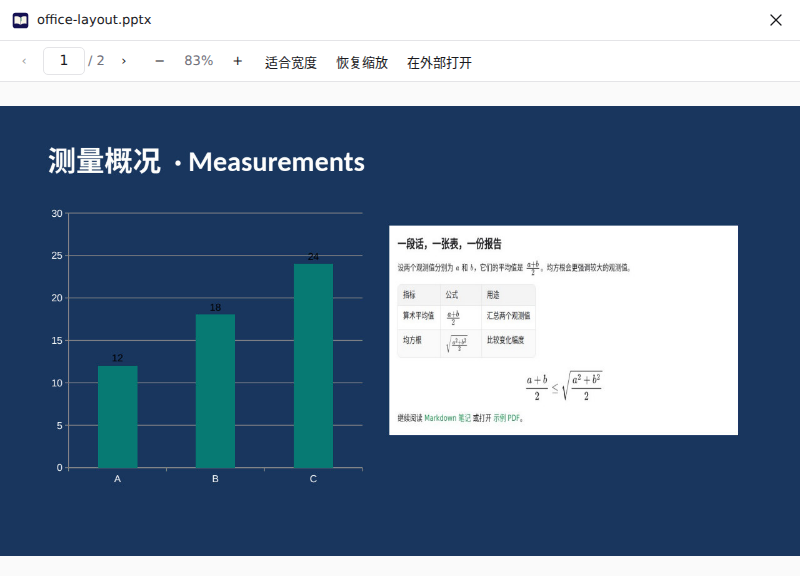

# Paseo Omni Reader

[English](README.md)

Omni Reader 是 Paseo 阅览增强插件。它为流式聊天加入 LaTeX 排版，也为工作区里的 Markdown、PDF、Word、Excel 和 PowerPoint 提供只读预览。


## 阅览体验

- **聊天公式。** 流式回复中的公式闭合后即可渲染。行内分数按分子和分母所需的高度排版，独立公式居中。表格按内容调整列宽，放得下时居中，宽表格和长代码各自横向滚动。浏览器悬停看 LaTeX 原文，点击复制。原生 App 长按任意公式即可查看或复制。点击回复下方的**还原原始回复**可切回 Paseo 的 Markdown，同一位置会显示**恢复增强渲染**。两种视图都使用 Paseo 的回合页脚。行内和独立公式都跟随 Paseo 的内容字号，在插件设置中可分别选择 50% 至 200% 的字号档位。
- **工作区文件。** 从聊天链接或文件树打开 Markdown、`.pdf`、`.docx`、`.xlsx` 和 `.pptx`。在 Paseo 的「打开位置」里，可分别设置聊天链接和文件树打开在主面板还是侧边。手机使用 Paseo 的文件预览窗口。Markdown 使用与聊天相同的公式设置，可切换预览和源码，长文档按需加载。
- **连续页面。** PDF 和带排版的 Office 预览按页上下排列。100% 时每页完整显示，宽度或高度贴合可用区域。滚轮上下滚动，按住左键拖动平移。点击预览后按 `+`、`-`、`0` 放大、缩小或恢复适合页面，也可使用工具栏缩放、适合宽度和跳页。原生 App 支持双指缩放和单指平移。
- **外部编辑。** 在 Paseo 桌面客户端中，本机守护进程上的文件可通过「在外部打开」交给系统默认应用打开原件。浏览器和桌面端的远程工作区下载副本。iOS 和 Android 通过系统分享交给其他 App。Android 系统分享不可用时，可从 Paseo 文件菜单下载副本。

| PDF 阅读器 | Office 预览 |
| --- | --- |
|  |  |

## 从 GitHub 安装

Paseo 客户端和 daemon 均需 0.17.5 或更新版本。通过 Git 安装时，daemon 主机需有 Node.js 22 或更新版本及 npm。

```sh
paseo plugin install github:Fu021/paseo-omni-reader
```

只有 Omni Reader 可用时，Paseo 会直接打开文件。如果 Paseo 询问 Markdown 的打开方式，选择 Omni Reader 并记住。手机端使用 Paseo 文件窗口右上角的关闭按钮。Paseo 使用简体中文时显示中文插件控件，其余语言使用英文。

## 数据和限制

插件读取当前工作区内的文件，守护进程通过 Paseo 连接发送预览结果。在运行 Paseo 守护进程的主机安装 LibreOffice Writer、Calc 和 Impress 后，Office 预览会保留排版、图片、图表和分页，浏览器和原生 App 使用同一套只读页面。未安装 LibreOffice 时，可查看基本文本和表格。PDF 预览上限为 128 MiB，Office 预览上限为 24 MiB。渲染失败的公式会保留源码并提供重试。

开发时可运行 `npm ci --include=dev --ignore-scripts`、`npm run typecheck`、`npm test` 和 `npm run check:package`。安装 LibreOffice Writer、Calc 和 Impress 后，可以运行 `npm run test:office` 验证 Office 排版预览。GitHub Actions 在 Linux 上使用 Node.js 22 和 24 执行检查，其中 Node.js 24 包含 LibreOffice 测试。插件市场介绍备有[简体中文](OVERVIEW.zh-CN.md)与 [English](OVERVIEW.md) 版本。
